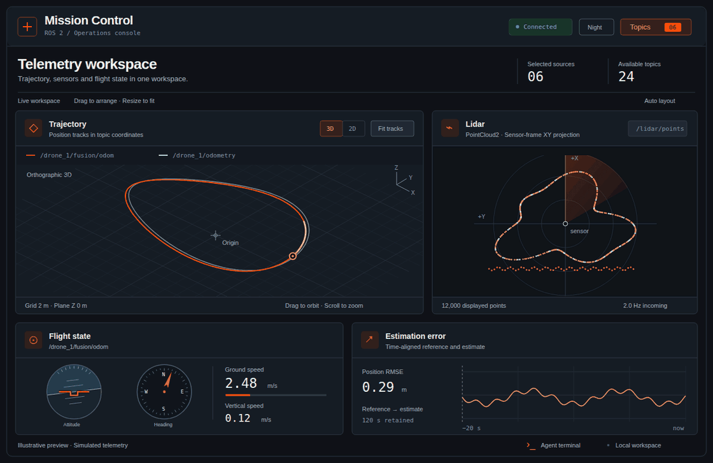

# Mission Control — ROS 2 telemetry dashboard



*Illustrative preview with simulated telemetry. [Animated SVG version](docs/assets/dashboard-preview.svg).*

Connect through **Topics**, enter a rosbridge WebSocket URL, and select the topics to display. Panels appear automatically; drag their handles or resize their lower-right corners. Camera and lidar each display one source at a time, chosen from their panel's source selector. Binary (CBOR) sensor transport is the default; use the panel's JSON compatibility option for older bridges. This shared transport setting applies to both sensor panels.

## Running and checks

```sh
npm install
npm run dev
npm run test
npm run lint
npm run build
npm run preview
```

Use the production preview when checking performance. `npm run test:browser` runs an isolated headless Chrome session against the built app and a mock rosbridge server; run `npm run build` first. It requires `google-chrome` on PATH, uses port 4189 for the preview and an ephemeral port for the bridge, and writes `/tmp/mission-sensor-preview.png`. It never connects to the robot. `npm run test:browser:dev` checks single-topic odometry selection, projection switches, and removal/reselection under the Vite development server and React StrictMode.

## Agent terminal

Open **Agent terminal** in the lower-right corner to save notes and prompts. It starts in local mode; messages remain in this browser and are never automatically replayed when an agent is attached. History retains the latest 60 messages. If browser storage is unavailable, history lasts only for the current session. **Clear history** removes the saved conversation. Enter submits, Shift+Enter adds a line, and Escape closes the terminal and returns focus to its launcher.

To connect a backend, pass a stable transport object to `ChatTerminal` in `src/App.jsx`. `createHttpAgentTransport` from `src/lib/agentTransport.js` supplies a JSON adapter for a backend you provide:

```jsx
import { createHttpAgentTransport } from './lib/agentTransport';

// Create once outside the component, then pass to <ChatTerminal transport={agentTransport} />.
const agentTransport = createHttpAgentTransport('/api/agent/chat');
```

The endpoint receives `POST { messages: [{ role, content }], context }` and returns `{ content: string }`. Context contains only connection status and selected topic names/types. Keep model credentials and authentication on your backend. This project does not supply an agent endpoint.

Custom adapters implement `send({ messages, context, signal, onDelta })`, returning a response string, `{ content: string }`, or streaming text through `onDelta(text)` before resolving. **Stop**, clearing history, changing the adapter and unmounting abort the active request; adapters should honor the supplied `AbortSignal`. Late responses are ignored. Partial replies restored after a reload appear as stopped.

## Supported displays

| Messages | Display |
| --- | --- |
| Odometry, PoseStamped, PoseWithCovarianceStamped, custom GnssFix | Trajectory, map, flight instruments and estimation error |
| NavSatFix | Map |
| CompressedImage | JPEG/PNG camera preview |
| Image | rgb8, bgr8, rgba8, bgra8, mono8 / 8UC1, mono16, 16UC1, 32FC1 |
| LaserScan | Top-down lidar scan |
| PointCloud2 | Sampled XY projection; numeric x/y/z fields with offsets, row padding and byte order respected |
| Imu | Acceleration, angular velocity, quaternion readouts |
| Standard numeric / Bool, Vector3 / Vector3Stamped, numeric arrays | Current scalar/vector values |
| DiagnosticArray | Up to 20 named statuses with severity and messages |
| Other types | Bounded latest-message preview |

ROS 1-style `sensor_msgs/Image` and ROS 2-style `sensor_msgs/msg/Image` type names both work. Lidar views show the **message's own sensor frame**, with +X up and +Y left. They do not apply TF transforms, accumulate scans, deskew moving scans, or provide a 3D point-cloud view.

Raw depth uses a fixed grayscale display: 16UC1 is interpreted as millimetres and 32FC1 as metres, with 0–10 m mapped to black–white; verify those conventions for your publisher. Invalid depth is black. mono16 uses the full 0–65535 intensity range. `compressedDepth`, Bayer, YUV and compressed TIFF are not supported; an explanatory message appears instead of a broken image.

## Performance budgets

- Bridge subscription requests: camera **20 Hz**, LaserScan **5 Hz**, PointCloud2 **2 Hz**, other topics **20 Hz**; outgoing subscription queue length is **1**. Selected camera/lidar sources that are not currently displayed, including paused previews, are limited to **1 Hz** to reduce bridge load. These are display feeds, not lossless recordings.
- Camera, lidar, IMU, vector, diagnostics and raw-message topics retain **only their latest message**. Trajectory/map buffers retain up to 120 seconds / 2,400 samples; scalar buffers retain up to 20 seconds / 2,400 samples.
- One worker per visible sensor panel category, at most one decoding job in flight per worker. Intermediate frames are skipped; no pending frame queue accumulates. Workers terminate on source changes, pause and unmount; transferred image bitmaps are closed after drawing.
- Decode/render work pauses off-screen, in hidden browser tabs and in Night mode. **Pause stops display processing and lowers that source to 1 Hz; the subscription remains active.** Deselect a topic in Topics to stop its transport and release its retained frame.
- Camera drawing is synchronized to browser paint, capped near 20 FPS with one frame in flight. The caption reports display FPS, worker decode time, incoming (RX) FPS and approximate decoded-payload MiB/s. RX stalled means no message has arrived for 1.5 seconds; it is distinct from slow drawing.
- Camera output is capped at **1280 × 720**; sensor binary inputs at **16 MiB**; camera inputs at **16 megapixels**; LaserScan inputs at one million rays. Oversized messages are replaced with a small error record after receipt. JPEG/PNG dimensions are checked before browser image decoding.
- Lidar decoding samples at most **12,000 points**, rendered on an 800 × 800 canvas. Subsampling can omit small obstacles; this is a monitoring preview.
- Heavy frames stay outside React state. Lightweight summaries update at 2 Hz; chart-library loading is deferred until a plot is actually needed.

The binary transport avoids base64 expansion and conversion for sensor byte arrays; it does not JPEG-compress raw images. Incoming network traffic and transport decoding still occur before the input guard. For high-resolution cameras, prefer a compressed JPEG/PNG topic; downsample large clouds at the ROS publisher and subscribe only to sources you need. Browser-side sampling cannot reduce bytes already sent over the network. This dashboard is not a replacement for rosbag recording or full-resolution analysis.

## Message format references

Decoding follows the ROS definitions for [Image](https://github.com/ros2/common_interfaces/blob/rolling/sensor_msgs/msg/Image.msg), [CompressedImage](https://github.com/ros2/common_interfaces/blob/rolling/sensor_msgs/msg/CompressedImage.msg), [LaserScan](https://github.com/ros2/common_interfaces/blob/rolling/sensor_msgs/msg/LaserScan.msg), and [PointCloud2](https://github.com/ros2/common_interfaces/blob/rolling/sensor_msgs/msg/PointCloud2.msg).

## Workspace layout

Sensor panels share a source row, a compact Settings menu for transport, and four status readouts: Display, Incoming, Decode and Payload. The automatic layout adapts camera/lidar proportions to the viewport and stacks displays on narrower screens. Drag or resize a panel to save a custom arrangement; Auto layout restores the defaults. The refreshed layout uses a new storage key; earlier arrangements remain stored under the previous key.

Flight state groups each trajectory source into a card with attitude, heading, and digital ground/vertical speed readouts. Neutral scales use the shared topic color only for pointers and bars. The estimation panel requires distinct reference and estimate sources and provides an explicit swap control; display-band thresholds remain visual defaults.

The trajectory viewer shares a lightweight WebGL stage between orthographic 3D and top-down XY modes. Fit tracks frames the retained history; dragging or zooming retains manual camera control until you fit again. Thin lines show sampled histories, and fixed-size rings mark the newest positions. Grid spacing and its reference Z plane are listed beneath the view; moving the cursor over the stage reads X/Y at that grid plane. Coordinates remain in each topic's frame, without TF transforms. The renderer draws only when data, camera, size or visibility changes and disposes its graphics resources on mode changes/unmount.
