# Mission Control — ROS 2 telemetry dashboard



*Illustrative preview with simulated telemetry.*

Connect through **Topics**, enter a rosbridge WebSocket URL, and select the topics to display. Panels appear automatically; drag their handles or resize their lower-right corners. Camera and lidar each display one source at a time, chosen from their panel's source selector. Binary (CBOR) sensor transport is the default; use the panel's JSON compatibility option for older bridges. This shared transport setting applies to both sensor panels.

Read [Networking from the beginning](docs/NETWORKING.md) for the laptop-to-phone communication path and [Change history](CHANGELOG.md) for the full LAN/mobile update.

## Flight instruments and workspace panels

Each drone gets its own **Flight state** panel, such as **Flight state · drone_1** and **Flight state · drone_2**. Within that panel, all of that drone's selected odometry/pose topics overlay on shared attitude and heading dials and ground/vertical-speed scales. Other drones stay in their own panels. Colored horizon lines, needles, source patterns, and marker shapes identify each topic. Hover, focus, or tap a source to highlight it within that drone's panel; press Escape to clear the highlight. The readout table gives exact values and frame names for each source. Panels can be moved, resized, hidden, and restored independently. Speed ranges expand independently for each drone. Missing orientation or velocity produces a blank reading and no corresponding marker. Values are the latest received per topic, without averaging, time alignment, or frame transformations; compare frame names when sources use different coordinate frames.

For example, `/drone_1/odometry` (long dashes, hollow triangle) and `/drone_1/fusion/odom` (solid, filled diamond) are drawn simultaneously inside the **same attitude dial**, **same heading dial**, and **same speed scales** in drone 1's panel. Close or identical estimates may overlap; their patterns, markers, numeric readings, and source highlighting help distinguish them.

Use the **minus button** in any panel header to move it into **Hidden panels**, above the workspace. Expand that drawer and select **Add back**, or **Restore all panels**. Hidden-panel choices persist in this browser, including across reloads. Hiding keeps your topic selections and retained telemetry; hidden visualizations release their rendering resources. Sensor source/pause/range settings, flight-overlay highlight, trajectory projection, and error-comparison settings are retained while hiding and restoring a panel. Saved panel sizes are kept. **Auto layout** resets positions and sizes independently of visibility. A panel can display again once a matching topic is selected.

## Analysis and Mission control

Use the **Analysis / Mission control** switch in the header. Analysis retains its existing panel layout, hidden-panel choices, projection settings, and comparison controls when switching views. The workspaces share the rosbridge connection, selected topics, and retained telemetry. Mission has a separate fixed layout and console history; it is loaded on first use. Inactive workspaces stop their high-rate React subscriptions, and inactive sensor views release their workers.

Mission control provides a fleet selector, a central map/trajectory/flight/sensor view, target telemetry, a command dock, and an embedded local console. Selecting a vehicle sets the command namespace and telemetry readout. **Whole fleet** chooses between fleet and target position views. Readouts identify their source and coordinate frame; unavailable values remain blank. The HUD prefers an available fusion source, with a stable fallback. It does not infer arming state, flight mode, battery health, or mission completion from odometry.

Choose **Add control** to configure a ROS service call or one-shot topic publication. Supply the control name, absolute endpoint, ROS type, and a JSON object request. The optional `{vehicle}` placeholder expands to the selected vehicle namespace with its original case. For example, `/{vehicle}/my_service` targets `/drone_1/my_service` when that namespace is selected. Endpoint names and request fields must match your robot; no arm/takeoff/land endpoints are guessed or preset.

Clicking a control opens an **inline request review**. Nothing is sent until **Send request**. Disconnected controls are unavailable. Service replies and publications are recorded in a bounded command log; a publication is marked unconfirmed, and a timeout/disconnect reports an unknown outcome. Pending requests interrupted by reload are retained as unknown outcomes. There are no automatic retries or command replay on reconnect/reload. These controls support service calls and single publications, rather than continuous joystick/offboard streaming or a built-in ROS action client. Control definitions and the command log are saved locally in this browser.

The **Mission console** supports `/help`, `/status`, `/topics`, and `/controls`. Ordinary text is saved as a local operational note. It is a deterministic local console, not a connected AI agent; it does not turn chat messages into vehicle commands. Mission console history is separate from Analysis's agent terminal. The existing agent transport contract remains available for a future configured adapter.

## Night lighting and Focus

**Night** applies low-light styling to the entire dashboard: black surfaces, subdued green interface markings, a dark map and 3D stage, and readable charts and instruments. It keeps all currently visible panels, their layout, topic selections, streams, and drone/source colors. Night no longer blanks panels or moves flight instruments to the top. The orange day theme returns when Night is off.

The **Dimmer** adjusts panel illumination from 40–100% in fine steps (default 75%). Camera imagery has an additional **Night image brightness** slider under the camera panel's **Settings**, from 20–100% (default 80%). It affects image pixels only and combines with the master dimmer; changing brightness never alters ROS data or transport. Both settings are saved in this browser.

**Focus** is a separate switch that works in either day or Night mode. In Focus, use **Show / Blank** in each panel header to choose which panels stay illuminated, including individual drone flight panels. Choices persist across Focus sessions, hiding/restoring panels, and reloads. Initially, flight panels are lit and other panels are blanked; enabling Night alone never activates Focus. Blank panels become compact standby headers with inert bodies, and camera/lidar previews suspend decoding under the existing background transport policy. Showing a sensor panel resumes its visible-preview budget. Focus temporarily arranges awake panels ahead of standby headers; switching it off restores the normal layout without overwriting saved positions. Normal layout editing remains available in Night, and is disabled while Focus is active.

**Automatic alerts are currently disabled at the operator’s request.** High estimation errors do not open banners, wake blank panels, restore hidden panels, or move the view. Error values, plots, and severity colors remain available by opening the comparison panel manually. Hidden comparisons do not run a background alert monitor while this policy is disabled.

Data panels show a compact reception status that expands into a per-topic list: **Live**, **Stale**, **Waiting**, **Connecting**, or **Disconnected**. Status refreshes even when messages stop. Stale means no reception for at least three seconds or approximately three observed message intervals, whichever is longer. Camera captions additionally distinguish a paused display, an unavailable preview, and a retained stale frame. Focus standby is intentional blanking; Hidden panels is the separate permanent visibility drawer. Status indicators describe receipt of data, not sensor correctness or synchronization.

The workspace starts directly with its panels. Hidden panels and Auto layout share a compact toolbar; the redundant page title, counters, display-count row, and permanent source-style explanation have been removed. Floating drone labels cache their dimensions and batch DOM updates. Charts defer loading until visible and freeze off-screen drawing while error/alert monitoring continues. Reception badges share a low-rate clock and rerender only when status changes; Night dimming uses opacity without per-track glow filters.

## Running and checks

```sh
npm install
npm run dev
npm run test
npm run lint
npm run build
npm run preview
```

Use the production preview when checking performance. `npm run test:browser` runs an isolated headless Chrome session against the built app and a mock rosbridge server; run `npm run build` first. It requires `google-chrome` on PATH, uses port 4189 for the preview and an ephemeral port for the bridge, and writes `/tmp/mission-sensor-preview.png`. It never connects to the robot. `npm run test:browser:dev` checks single-topic odometry selection, projection switches, and removal/reselection under the Vite development server and React StrictMode.

For a repeatable synthetic multi-drone performance profile, build first and run `npm run test:performance`. It records browser main-thread time, layout work, and frame cadence while viewing trajectories, instruments, and error charts in day and Night modes. Results are written to `/tmp/mission-performance.json`. This isolated headless-browser workload is useful for comparisons, rather than a measurement of your phone or a live ROS deployment.

## Phone and local-network access

Start rosbridge on the PC or robot, then run:

```sh
npm run serve:lan
```

This builds the dashboard and starts a static HTTP server on port **4173**, listening on all network interfaces. Open the printed **Phone / LAN** address on a phone connected to the same reachable network. The PC must remain running; allow inbound TCP port 4173 in its firewall if needed. Guest Wi-Fi client isolation can prevent devices reaching each other.

The server forwards `/rosbridge/preview` to `ws://127.0.0.1:2019` by default. The dashboard fills in that same-origin proxy address automatically: open **Topics → Connect**. This endpoint prepares smaller camera images on the host when Mobile mode is active. The phone does not need direct access to the bridge port. Configure a different bridge machine, port, or path with:

```sh
npm run serve:lan -- --bridge ws://192.168.1.20:9090 --port 4173
```

`ROSBRIDGE_URL` also sets the upstream URL. Use `--host 192.168.1.10` to bind only a particular interface. To serve an existing build without rebuilding, run `node scripts/serve-lan.mjs` with the same options. The server supports binary CBOR and JSON and applies socket backpressure. The legacy `/rosbridge` endpoint remains an unchanged byte-stream proxy. The server does not launch ROS or rosbridge.

This HTTP service is intended for a trusted LAN and has no login. Keep it off the public internet. For encrypted access, place it behind an HTTPS reverse proxy that forwards WebSocket upgrades and preserves the original Host and Origin; the dashboard automatically uses WSS on HTTPS pages. On other static hosts, the default direct bridge URL uses the page hostname and port 2019; edit it in Topics as needed. Map tiles still require internet access.

### Mobile performance

**Topics → Performance** offers **Auto**, **Mobile**, and **Desktop**. Auto selects Mobile for screens at most 700 CSS pixels wide or devices with a coarse primary pointer. A manual choice is saved in that browser and takes effect immediately.

| Budget | Desktop | Mobile |
| --- | --- | --- |
| Camera output / requested rate | Up to 1280 × 720 / 20 FPS | Up to 640 × 360 / 10 FPS, further limited by payload size |
| LaserScan / PointCloud2 request rate | 5 Hz / 2 Hz | 2 Hz / 1 Hz |
| Lidar drawing | 12,000 points, 800 × 800 canvas | 3,000 points, 480 × 480 canvas |
| Instruments / trajectory updates | Up to 20 Hz | Up to 10 Hz |
| Position history | 120 seconds / 2,400 samples | 60 seconds / 600 samples |
| Trajectory rendering | 600 samples, pixel ratio ≤ 1.5 | 300 samples, pixel ratio ≤ 1, antialiasing off |

Mobile starts trajectories in top-down XY; both XY and 3D still use WebGL. Scalar history remains 20 seconds, with the selected preset's sample cap. Switching presets trims existing history immediately. Desktop requests off-screen, hidden-tab, paused and Night-mode sensor feeds at **1 Hz**. Mobile unsubscribes those sensor sources until they become visible/active again, preserving the selected topics and last frames. Decoding/drawing pauses in either mode; deselect a topic to release its retained frame entirely.

On the default `/rosbridge/preview` connection, **Mobile resizes camera images on the host before transmission**, preserving aspect ratio within 640 × 360. Color becomes JPEG (quality 72); monochrome/depth becomes PNG using the existing grayscale display scale. Depth PNG is a display visualization, not a depth measurement format. Original ROS topics and their data remain unchanged. Desktop forwards the original images. One host worker per connection processes at most one image at a time, skipping intermediate images; non-camera telemetry continues flowing during encoding. Source changes and disconnects discard obsolete work.

Mobile also shares an approximate **2 MiB/s payload budget** across active camera/lidar feeds, measured from what the browser actually receives (including base64 expansion in JSON mode). A new stream initially requests one frame every 3 seconds, then adjusts after measuring its payload. Host-compressed images can reach 10 FPS. With a direct bridge connection or the legacy `/rosbridge` proxy, raw images remain full-size on the wire: a raw 1920 × 1080 RGB image is about 6 MiB and therefore updates about once every 3 seconds with one sensor visible. This is an average subscription-rate guard, not a hard network shaper. Low rates are shown with fractional FPS and a rate-aware stall timeout.

The phone decodes and renders the smaller previews locally. Camera encoding uses the host CPU; raw image traffic still travels between rosbridge and the host, so prefer smaller/compressed publications when the robot-to-host link is constrained. Point clouds are not downsampled by the proxy; downsample them upstream to reduce their network and input-processing costs. Each open browser has its own subscriptions and settings. Mobile emulation tests verify budgets and layout, but real-device battery and thermal performance should be checked with your own telemetry.

`npm run test:browser:lan` runs the sensor/navigation browser checks through the actual LAN server and proxy against a mock rosbridge; build first. It also checks automatic mobile budgets and off-screen throttling.

## Agent terminal

Open **Agent terminal** in the lower-right corner to save notes and prompts. It starts in local mode; messages remain in this browser and are never automatically replayed when an agent is attached. History retains the latest 60 messages. If browser storage is unavailable, history lasts only for the current session. **Clear history** removes the saved conversation. Enter submits, Shift+Enter adds a line, and Escape closes the terminal and returns focus to its launcher.

To connect a backend, pass a stable transport object to `ChatTerminal` in `src/App.jsx`. `createHttpAgentTransport` from `src/lib/agentTransport.js` supplies a JSON adapter for a backend you provide:

```jsx
import { createHttpAgentTransport } from './lib/agentTransport';

// Create once outside the component, then pass to <ChatTerminal transport={agentTransport} />.
const agentTransport = createHttpAgentTransport('/api/agent/chat');
```

The endpoint receives `POST { messages: [{ role, content }], context }` and returns `{ content: string }`. Context contains only connection status and selected topic names/types. Keep model credentials and authentication on your backend. This project does not supply an agent endpoint.

Custom adapters implement `send({ messages, context, signal, onDelta })`, returning a response string, `{ content: string }`, or streaming text through `onDelta(text)` before resolving. **Stop**, clearing history, changing the adapter and unmounting abort the active request; adapters should honor the supplied `AbortSignal`. Late responses are ignored. Partial replies restored after a reload appear as stopped.

## Supported displays

The **Trajectory** legend groups tracks by vehicle namespace, such as `/drone_1` and `/drone_2` (case-insensitive for visual grouping). Each vehicle has a stable color family, independent of selection order. Source names determine the shade and line style: **fusion / EKF / UKF = solid**, **IMU / INS = dotted**, **GPS / GNSS / RTK = dashed**, and **ground truth / reference = long dashes**. The same source convention applies across vehicles, and the legend retains the remaining topic path so individual feeds can be identified. Nested paths such as `/fleet/drone_1/gps/odom` are supported; other names use their first namespace. Unnamespaced topics appear together. These are visual groupings only; topic subscriptions and coordinate frames are unchanged. IMU tracks require a position-bearing estimate; raw `sensor_msgs/Imu` messages remain readouts.

The interface retains its **orange accent**, independently of the restrained vehicle palette (steel blue for drone 1, warm ochre for drone 2, then sage, slate violet, copper, blue gray, olive, and silver). Numbered vehicles and arbitrary namespaces both use this curated palette. Source shades stay close to each vehicle's base color; line patterns identify the source without washing the group toward white. A single topic style in `src/lib/topicStyles.js` supplies the exact same color to trajectory tracks, map trails and position markers, flight pointers and speed bars, comparison selectors, topic selection, sensor source labels, readout cards, and lidar points. Line patterns also match in the map and legend. The estimation-error trace follows the estimate's color and pattern for every metric; swapping roles updates it. Camera imagery keeps its original colors, and status/severity indicators retain their meanings.

**Drone labels:** the 2D/3D trajectory stage and navigation map show one floating name tag per visible vehicle, connected to its latest position by a leader line. The tag includes the source path it follows: fusion first, then odometry, reference, IMU, GPS, or another available source. This selects a label anchor only; tracks and coordinates remain separate. Labels follow zoom/pan, stay within their panel, and are offset to reduce overlap. Matching vehicle badges identify flight cards, camera/lidar feeds, comparison roles and charts, readout cards, and trajectory legend groups. Topics without a namespace are labeled “Unnamespaced.”

| Messages | Display |
| --- | --- |
| Odometry, PoseStamped, PoseWithCovarianceStamped, custom GnssFix | Trajectory, map, flight instruments and estimation error |
| NavSatFix | Map |
| CompressedImage | JPEG/PNG camera preview |
| Image | rgb8, bgr8, rgba8, bgra8, mono8 / 8UC1, mono16, 16UC1, 32FC1 |
| LaserScan | Top-down lidar scan |
| PointCloud2 | Sampled XY projection; numeric x/y/z fields with offsets, row padding and byte order respected |
| Imu | Acceleration, angular velocity, quaternion readouts |
| Standard numeric / Bool, Vector3 / Vector3Stamped, numeric arrays | Current scalar/vector values |
| DiagnosticArray | Up to 20 named statuses with severity and messages |
| Other types | Bounded latest-message preview |

ROS 1-style `sensor_msgs/Image` and ROS 2-style `sensor_msgs/msg/Image` type names both work. Lidar views show the **message's own sensor frame**, with +X up and +Y left. They do not apply TF transforms, accumulate scans, deskew moving scans, or provide a 3D point-cloud view.

Raw depth uses a fixed grayscale display: 16UC1 is interpreted as millimetres and 32FC1 as metres, with 0–10 m mapped to black–white; verify those conventions for your publisher. Invalid depth is black. mono16 uses the full 0–65535 intensity range. `compressedDepth`, Bayer, YUV and compressed TIFF are not supported; an explanatory message appears instead of a broken image.

## Performance budgets

- Desktop bridge subscription requests: camera **20 Hz**, LaserScan **5 Hz**, PointCloud2 **2 Hz**, other topics **20 Hz**; Mobile uses the lower rates and payload budget above. Outgoing subscription queue length is **1**. Desktop limits selected camera/lidar sources that are not currently displayed, including paused previews, to **1 Hz**; Mobile stops those subscriptions until displayed again. These are display feeds, not lossless recordings.
- Camera, lidar, IMU, vector, diagnostics and raw-message topics retain **only their latest message**. Desktop trajectory/map buffers retain up to 120 seconds / 2,400 samples; scalar buffers retain up to 20 seconds / 2,400 samples. Mobile lowers these limits as listed above.
- One worker per visible sensor panel category, at most one decoding job in flight per worker. Intermediate frames are skipped; no pending frame queue accumulates. Workers terminate on source changes, pause and unmount; transferred image bitmaps are closed after drawing.
- Decode/render work pauses off-screen, in hidden browser tabs and in Night mode. **Pause lowers that source to 1 Hz on Desktop and stops its subscription on Mobile.** Deselect a topic in Topics to release its retained frame as well.
- Camera drawing is synchronized to browser paint, capped near 20 FPS on Desktop and 10 FPS on Mobile, with one frame in flight. The caption reports display FPS, worker decode time, incoming (RX) FPS and approximate decoded-payload MiB/s. The stall timeout is at least 1.5 seconds and increases for intentionally slow subscription rates; it is distinct from slow drawing.
- Camera output is capped at **1280 × 720**; sensor binary inputs at **16 MiB**; camera inputs at **16 megapixels**; LaserScan inputs at one million rays. Oversized messages are replaced with a small error record after receipt. JPEG/PNG dimensions are checked before browser image decoding.
- Lidar decoding samples at most **12,000 points**, rendered on an 800 × 800 canvas. Subsampling can omit small obstacles; this is a monitoring preview.
- Heavy frames stay outside React state. Readings update at 2 Hz; other panels use independent bounded update cadences. Chart-library loading is deferred until a plot is actually needed.

The binary transport avoids base64 expansion and conversion for sensor byte arrays; it does not JPEG-compress raw images. Incoming network traffic and transport decoding still occur before the input guard. For high-resolution cameras, prefer a compressed JPEG/PNG topic; downsample large clouds at the ROS publisher and subscribe only to sources you need. Browser-side sampling cannot reduce bytes already sent over the network. This dashboard is not a replacement for rosbag recording or full-resolution analysis.

## Message format references

Decoding follows the ROS definitions for [Image](https://github.com/ros2/common_interfaces/blob/rolling/sensor_msgs/msg/Image.msg), [CompressedImage](https://github.com/ros2/common_interfaces/blob/rolling/sensor_msgs/msg/CompressedImage.msg), [LaserScan](https://github.com/ros2/common_interfaces/blob/rolling/sensor_msgs/msg/LaserScan.msg), and [PointCloud2](https://github.com/ros2/common_interfaces/blob/rolling/sensor_msgs/msg/PointCloud2.msg).

## Workspace layout

Sensor panels share a source row, a compact Settings menu for transport, and four status readouts: Display, Incoming, Decode and Payload. The automatic layout adapts camera/lidar proportions to the viewport and stacks displays on narrower screens. Drag or resize a panel to save a custom arrangement; Auto layout restores the defaults. The refreshed layout uses a new storage key; earlier arrangements remain stored under the previous key.

Flight state groups sources by drone, with each drone's estimates overlaid in its own panel. Neutral scales use the shared topic colors for horizons, needles, and markers. The estimation panel requires distinct reference and estimate sources and provides an explicit swap control; display-band thresholds remain visual defaults.

The trajectory viewer shares a lightweight WebGL stage between orthographic 3D and top-down XY modes. Fit tracks frames the retained history; dragging or zooming retains manual camera control until you fit again. Thin lines show sampled histories, and fixed-size rings mark the newest positions. Grid spacing and its reference Z plane are listed beneath the view; moving the cursor over the stage reads X/Y at that grid plane. Coordinates remain in each topic's frame, without TF transforms. The renderer draws only when data, camera, size or visibility changes and disposes its graphics resources on mode changes/unmount.
