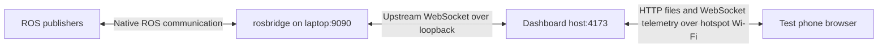
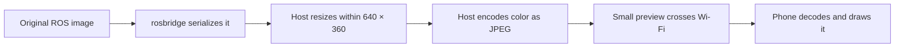

# Networking from the beginning: how Mission Control reaches your phone

This guide assumes no networking background. It explains the running implementation, including why the first local-network camera stream was too large and how host-side image preparation changed that.

The core arrangement is: **ROS produces measurements, rosbridge makes them available to web clients, the laptop serves and prepares data, and the phone displays it.** Loading the page and receiving live measurements are separate activities.

## Devices, networks, and programs

A network lets devices exchange data. Your hotspot experiment had three devices: the hotspot phone, the laptop, and the test phone. The hotspot provided a Wi-Fi access point that connected the other two devices. It typically also assigned their local addresses.

An internet connection is a route to networks outside this local group. The laptop and test phone can exchange local dashboard traffic without sending it through a cloud service. The core dashboard/telemetry path does not require GitHub or mobile internet after the software is installed. Map tiles are an exception: the map requests them from an external provider.

The network connects devices, but the conversations are between **programs**. A browser is one program; the dashboard's Node server is another; rosbridge is another. Several of these programs can run on the same laptop and communicate without using Wi-Fi.

The words **client** and **server** describe roles. The browser is a client when it requests the webpage. The dashboard host is a server to the browser, but it is also a client when it opens an upstream connection to rosbridge. One program can perform both roles.

## IP addresses, ports, and paths

An IP address identifies a network interface. For example, a laptop might receive `192.168.1.50` on one Wi-Fi network and a different address on another. These are example addresses, not a promise about your current setup.

Three address forms caused practical confusion during testing:

| Address | Meaning |
| --- | --- |
| The laptop's Wi-Fi address | What another device uses to reach the laptop |
| `127.0.0.1` or `localhost` | The device on which the requesting program is running |
| `0.0.0.0` in the server's bind setting | Listen on all local IPv4 interfaces; not an address to enter on the phone |

On the laptop, `localhost` means the laptop. On the test phone, it means the test phone. A phone opening `http://localhost:4173` therefore asks a program on the phone for the page.

A **port** identifies a service endpoint on an addressed device. The dashboard's default port is 4173. Your live rosbridge test used 9090; the dashboard's upstream default is 2019 unless overridden. These port numbers are configuration choices, not properties of Wi-Fi or ROS topic names.

Break down this example:

```text
http://192.168.1.50:4173/rosbridge/preview
│      │              │    │
│      │              │    └─ path handled by the server
│      │              └────── server port
│      └───────────────────── laptop address
└──────────────────────────── protocol scheme
```

The websocket URL uses `ws://` instead of `http://`. The `/rosbridge/preview` path is not a ROS topic. It selects a handler in the dashboard server. That one endpoint can carry many ROS topics.

The phone normally chooses its own temporary source port when connecting. Port 4173 is the destination service port; both ends do not need to use the same number.

DHCP is the usual mechanism by which the hotspot assigns addresses. Rejoining a hotspot or changing networks can change the laptop's address. We observed address changes during testing. A stale URL can fail even though the server is still running. Listening on all interfaces makes the server available on the new interface address, but it does not keep an old address valid.

## What happens when the page opens

The browser first needs the application files. It makes HTTP requests such as:

```text
GET /
GET /assets/index-<build-hash>.js
GET /assets/index-<build-hash>.css
GET /dashboard-config.json
```

HTML supplies the page structure, CSS supplies presentation, and JavaScript supplies the application behavior. `npm run build` prepares these files in `dist`. The Node server serves that directory. `npm run serve:lan` performs the build and starts this server.

An HTTP response includes a status and headers. `200` indicates a successful response. `404` means the requested resource was not found. The Content-Type header tells the browser whether the returned bytes represent HTML, JavaScript, an image, or another format. HTTP is a request/response application protocol. [MDN's HTTP overview](https://developer.mozilla.org/en-US/docs/Web/HTTP/Guides/Overview).

Built assets have names containing build hashes and can be cached for a long time. The runtime configuration is marked `no-store`, so the browser does not reuse an outdated bridge setting. The initial HTML is revalidated rather than treated as permanently immutable.

The configuration response is small:

```json
{"bridgePath":"/rosbridge/preview"}
```

The browser combines that path with the page's host and port. Opening `http://192.168.1.50:4173` therefore produces a bridge URL of `ws://192.168.1.50:4173/rosbridge/preview`. This avoids making the phone guess where rosbridge is running.

At this point the browser can show a completely functional interface while receiving no robot measurements. Successful page loading proves the HTTP file-serving path works. It does not prove that a telemetry publisher is running or that any topic is delivering samples.

## Why live telemetry uses WebSocket

Repeatedly asking an HTTP endpoint for every camera frame would require a polling arrangement. WebSocket instead establishes a persistent, bidirectional connection: the client can request a subscription and the server can send subsequent updates without a separate browser request for each one. WebSocket supports text and binary messages. [MDN's WebSocket API guide](https://developer.mozilla.org/en-US/docs/Web/API/WebSockets_API).

In this implementation, opening the connection starts with an HTTP Upgrade handshake. A successful upgrade changes that connection to WebSocket and uses status `101 Switching Protocols`. An ordinary HTTP GET to the bridge path is not a subscription; the host responds that a WebSocket upgrade is required.

Once connected, small subscription commands travel toward the bridge and telemetry travels back toward the browser. These directions share a bidirectional connection. In the normal dashboard flow, one browser's multiple selected topics share its rosbridge WebSocket connection.

These browser-side connections run over **TCP**. TCP provides an ordered byte stream and handles retransmission and flow control. It does not guarantee that bytes arrive quickly enough for a fresh camera view. A network can deliver data reliably but too late to be useful for live monitoring.

A camera image, a WebSocket message, and a network packet are different units. A large image can span many network packets. TCP does not preserve application-message boundaries; the WebSocket implementation reconstructs messages for the application. Dropping old images later in JavaScript cannot remove the bytes already transmitted to deliver them.

## How ROS fits into the picture

ROS 2 organizes robot software into communicating components called nodes. A camera driver or simulator can publish image messages; another component can publish position and orientation. A **topic** is the name under which a stream is published, such as `/drone_1/odometry`. A **subscriber** asks to receive that stream.

A message type defines the fields in each sample. `nav_msgs/msg/Odometry` describes position/orientation and velocity-related data. `sensor_msgs/msg/Image` includes image dimensions, encoding, row stride, and pixel bytes. Knowing the topic name alone does not tell the browser how to interpret the payload. ROS topics are typed publish/subscribe interfaces. [Official ROS topic documentation](https://github.com/ros2/ros2_documentation/blob/rolling/source/ROS-Framework/interfaces/About-Topics.rst).

The name of a topic is not a filename, URL, IP address, or TCP port. Adding another ROS topic does not require opening another firewall port for the phone.

Native ROS 2 communication commonly uses DDS middleware. Its discovery and transport settings depend on the installed ROS middleware and configuration. The phone's browser does not join that native communication system directly. It does not need its own ROS installation or a matching ROS domain setting; the bridge is the participant that connects to the ROS graph.

Discovery means learning what endpoints/topics exist. It is separate from receiving messages. A discovered topic might be idle, have no current publisher, or have communication compatibility problems.

ROS Quality of Service, abbreviated **QoS**, describes delivery policies such as reliability, retained history, and durability. A publisher and subscriber need compatible settings. For example, a subscriber requiring reliable delivery is not compatible with a publisher offering only best-effort delivery. This is a different issue from browser frame rate or the dashboard's bandwidth preset. [Official ROS QoS documentation](https://github.com/ros2/ros2_documentation/blob/rolling/source/ROS-Framework/interfaces/topics/About-Quality-of-Service-Settings.rst).

## rosbridge translates between the two environments

rosbridge supplies a web-accessible interface to ROS operations. The browser uses `roslib` to speak the rosbridge protocol over WebSocket. The bridge creates or manages the relevant native ROS subscriptions and sends samples back as web messages. `rosapi` supplies discovery services used by the dashboard. [RobotWebTools project documentation](https://github.com/RobotWebTools/rosbridge_suite).

There are two different interaction patterns in the dashboard:

| Interaction | Purpose |
| --- | --- |
| Service request through rosapi | Ask for the topic names and types available now |
| Topic subscription | Receive ongoing samples from a selected stream |

A simplified discovery request looks like this:

```json
{"op":"call_service","service":"/rosapi/topics","id":"topics-1","args":{}}
```

The `id` helps correlate a response with the request. The real client library manages its own identifiers. The response contains names and types that populate the Topics panel.

A simplified subscription for a Mobile camera looks like this after the initial payload has been measured:

```json
{
  "op": "subscribe",
  "topic": "/drone_1/camera/image",
  "type": "sensor_msgs/msg/Image",
  "compression": "cbor",
  "throttle_rate": 100,
  "queue_length": 1
}
```

The request asks for at least 100 ms between forwarded samples, corresponding to a nominal maximum of 10 samples per second. `queue_length: 1` limits the bridge's subscription queue; it does not promise that only one message exists anywhere in the network. The bridge protocol defines these fields. [roslib subscription interface](https://robotwebtools.github.io/roslibjs/interfaces/RosbridgeSubscribeMessage.html).

Telemetry comes back in a publish envelope containing a topic and a message. A browser receiving an `op: "publish"` envelope is consuming forwarded ROS data; that operation name does not mean that the dashboard is commanding the vehicle.

Unsubscribing removes the browser's request for that stream. It does not stop the original ROS publisher or the robot's other subscribers. Monitoring is one consumer among potentially many.

## Why the laptop is also a proxy

The phone connects to the dashboard host on port 4173. The host opens a separate upstream connection to rosbridge, such as `ws://127.0.0.1:9090`. The phone does not need to connect to port 9090 itself.



This diagram assumes rosbridge runs on the laptop, as in the live test. If it runs on a separate robot, the upstream connection crosses that robot-to-laptop network instead of loopback. The hotspot carries the local phone-to-laptop traffic; it does not encode camera images.

This is a **reverse proxy** arrangement: clients contact one server-facing address, and that server contacts the configured upstream service. The host terminates the preview WebSocket and opens another one upstream. There is not one unbroken TCP connection from the phone to the ROS publisher.

Both the webpage and the browser-facing WebSocket use the same host and port. This makes configuration easier and lets a future TLS reverse proxy provide one public entry point. The `ws://` connection is related to the HTTP page's origin even though its scheme is WebSocket-specific.

The host has two routes. `/rosbridge` forwards the WebSocket byte stream unchanged. `/rosbridge/preview` understands selected rosbridge messages and can prepare camera images for Mobile mode. A direct connection to rosbridge also remains possible, but it bypasses host camera preparation.

## JSON, base64, and CBOR

Structured measurements need a representation that programs can exchange. Turning in-memory values into an exchangeable representation is **serialization**. Reconstructing the values is **deserialization**.

JSON is readable text, for example `{"x":1.2,"y":3.4}`. It works well for small commands. Raw camera pixels are arbitrary bytes, however, and JSON has no native byte-string type. In rosbridge's JSON image representation, binary data is commonly carried as base64 text.

Base64 turns groups of three bytes into four text characters, plus padding where needed. That adds roughly one third to the data size. It does not make the image smaller and does not encrypt it. [Base64 specification, RFC 4648](https://www.rfc-editor.org/rfc/rfc4648.html).

CBOR is a binary serialization format that can represent byte strings directly. The dashboard requests it for camera/lidar messages by default, avoiding base64 conversion and expansion for their binary arrays. Small non-sensor messages use the ordinary JSON path. [CBOR specification, RFC 8949](https://www.rfc-editor.org/rfc/rfc8949.html).

Keep three operations distinct:

| Operation | Effect |
| --- | --- |
| Serialization, such as JSON or CBOR | Defines how values are represented for exchange |
| Image compression, such as JPEG or PNG | Encodes image content more compactly |
| Encryption, such as TLS | Protects a connection against reading/tampering in transit |

Choosing CBOR does not automatically JPEG-compress a raw RGB image. In our Mobile preview path, the host explicitly makes JPEG/PNG images and then places their bytes in the chosen rosbridge transport representation.

## Bandwidth, delay, and the original camera problem

**Bandwidth capacity** is how much data a link can carry per second. **Throughput** is how much it actually carries. **Latency** is how long data takes to arrive. **Jitter** is variation in that delay. A preview can be sharp but delayed, or fresh but infrequent; those are different tradeoffs.

Network speeds are often quoted in bits per second. Files and image buffers are usually measured in bytes. One byte is eight bits. MB means 1,000,000 bytes; MiB means 1,048,576 bytes. Mixing these units can hide a large difference between the requested stream and a Wi-Fi link's capacity.

The live color camera published 1920 × 1080 RGB pixels. With three bytes per pixel and no row padding, its size is:

```text
1920 × 1080 × 3 = 6,220,800 bytes per image
                 ≈ 6.22 MB or 5.93 MiB

At 10 images/second:
6,220,800 × 10 = 62,208,000 bytes/second
               ≈ 498 megabits/second, before protocol overhead
```

JSON base64 would make the same image about 8.29 MB before the rest of the message. Actual wireless throughput is affected by signal, contention, retransmission, and device capabilities, so a nominal Wi-Fi link speed is not a promise of that much usable application capacity.

Our local browser test measured approximately 56 MiB/s from the original feed. Drawing it on a small phone screen did not change its incoming size. Resizing it after arrival saved some drawing/decoding work but still required the large original message to cross Wi-Fi.

The first fix requested fewer raw frames, keeping average payload near 2 MiB/s. That made a roughly 6 MiB image arrive only about once every three seconds. It protected the link but gave a slow preview. The later fix moved image preparation before the laptop-to-phone hop.

The general rule is: **reduce data before the constrained link if the goal is to save capacity on that link.** Reducing it after the link can save downstream computation, but cannot recover the network cost already paid.

## What the host now does to a Mobile camera frame

The browser sends this dashboard-specific control message only to the preview endpoint:

```json
{"op":"mission_control_preview","profile":"mobile"}
```

The gateway consumes it locally. It is not a ROS command and is not forwarded to rosbridge. Desktop mode selects forwarding of the original images; Mobile enables the host's preview preparation.

A raw color image now follows this path:



Aspect ratio is preserved. A 1920 × 1080 source fits as 640 × 360. A 640 × 480 source fits as 480 × 360. JPEG quality 72 is a monitoring compromise between size and visual detail. File size still depends on scene content.

Depth and monochrome images use PNG. For raw depth, the host first makes the same eight-bit grayscale display that the browser previously made. The fixed depth scale maps 0–10 m into brightness, with invalid values black. This means the transmitted PNG is a picture of depth, not the original floating-point or integer depth array. PNG preserves that display image; the transformation and resizing have already reduced the measurement information.

The upstream ROS topic remains unchanged. Its name/type and original publisher are not replaced. The gateway changes only the monitoring representation delivered to this browser, and keeps the frame header. The frontend knows how to display that representation within its camera panel.

If rosbridge is on the same laptop, the large raw message crosses loopback before encoding. If rosbridge is on a remote robot, that large message must still cross the robot-to-host link. Moving preparation onto the laptop therefore fixes the phone hop; compressing/downsampling at the robot is preferable when the earlier hop is also constrained.

In live browser checks after this change, color reached roughly 9–10 FPS at 640 × 360 with approximately 0.1 MiB/s in that scene, and depth reached about 10 FPS at 480 × 360. Scene complexity, publisher rate, host load, and the physical phone/network can change those results.

## Queues, backpressure, and keeping the preview fresh

A queue holds work that has arrived but has not been processed. If a camera produces 30 images each second and the receiver handles 10, preserving every image adds a backlog of 20 images per second. After a while, a smooth display can be showing events from far in the past.

This dashboard is a monitor, so it deliberately favors fresh samples. The bridge request uses a small queue; sensor buffers retain the latest message; a busy browser decoder does not accumulate a frame queue; and the host camera encoder skips intermediate arrivals while busy. Position/chart histories use separate bounded buffers because their past samples are useful.

The host encoder uses a worker thread, separate from the Node thread handling network events. The phone uses a browser Web Worker for sensor decoding, separate from much of the UI work. These workers have different locations and responsibilities. Adding a browser worker alone does not move computation off the phone.

**Backpressure** is the mechanism by which a slower receiver slows the sender's progress through a pipeline. The proxy pauses upstream reading while downstream writes are pending. This helps bound local buffering, but does not give infinite capacity or eliminate every buffer in ROS, TCP, or the operating system. The browser WebSocket API also does not automatically solve application-level processing backlog, which is why the latest-frame policy still matters. [MDN's discussion of WebSocket backpressure](https://developer.mozilla.org/en-US/docs/Web/API/WebSockets_API).

Large image messages can delay smaller updates sharing the same ordered stream. TCP delivery order, message reconstruction, and application queues all matter. One subscription queue of length one is useful, but is not an end-to-end latency guarantee.

## The Mobile budget and what the counters mean

Mobile's nominal limits include a 10 FPS camera, 2 Hz LaserScan, 1 Hz PointCloud2, 3,000 displayed lidar points, 10 Hz instruments/trajectory updates, and 60 seconds / 600 retained position samples. The rates are maximum requests rather than guarantees that a publisher produces that much data.

Camera/lidar streams share an approximate 2 MiB/s payload budget. The client estimates each frame's size, divides the budget among active sensors, and chooses an interval large enough for that size. It rounds estimates/rates conservatively. This policy is not an exact network shaper: initial frames, protocol overhead, buffering, and variable frame sizes still exist.

Mobile unsubscribes hidden/paused sensor sources and restores them when active. Desktop leaves those sources at a low 1 Hz rate. Selection and transport activity are therefore different: a source may remain selected while its Mobile subscription is temporarily stopped. Deselecting also releases its retained frame.

The camera panel displays only one selected source at a time. Checking both color and depth in Topics makes both available in Source; use that selector to choose which one is currently displayed.

| Counter | What it measures |
| --- | --- |
| Incoming FPS | Message arrivals observed by the browser |
| Display FPS | Successfully decoded/drawn frames during the reporting interval |
| Decode time | Browser sensor-worker processing time |
| Payload MiB/s | Approximate sensor payload rate after transport decoding |

Decode time excludes much of the network delay and host encoding time. Payload is not a complete Wi-Fi traffic measurement: it does not include all TCP/WebSocket/Wi-Fi overhead and does not display base64 expansion as raw interface traffic. A tiny compressed stream can round to `0.0 MiB/s` while Incoming/Display remain nonzero. An intentionally slow preview has a longer stall timeout and fractional FPS reporting.

## Firewalls, HTTPS, and access control

A listening server and a firewall perform different jobs. Binding `0.0.0.0:4173` lets the process accept connections on its IPv4 interfaces. A firewall can still reject incoming connections before they reach that process.

For example, if the actual hotspot subnet is `192.168.1.0/24`, a scoped UFW rule could be:

```sh
sudo ufw allow from 192.168.1.0/24 to any port 4173 proto tcp
```

Use your actual subnet; this is an example. `/24` describes the address prefix, commonly corresponding here to addresses sharing the first three IPv4 numbers. A rule for a previous hotspot subnet may not match a new one. Some hotspots also isolate clients from each other, independently of the laptop's firewall.

Plain HTTP/WS does not provide application-layer TLS encryption. HTTPS/WSS adds TLS, which protects the respective connection and uses certificates for server identity. The built-in Node host is currently plain HTTP; it does not create or manage certificates.

For an HTTPS deployment, an outer reverse proxy can terminate TLS and forward local HTTP/WebSocket traffic to this server. It must forward WebSocket upgrades and preserve the Host/Origin information needed by the gateway. HTTPS browser pages should use WSS for telemetry; an insecure `ws://` connection can be blocked as mixed content. [MDN's WebSocket security guidance](https://developer.mozilla.org/en-US/docs/Web/API/WebSockets_API/Writing_WebSocket_client_applications#security_considerations).

Encryption is different from **authentication**, which establishes who a client is, and **authorization**, which establishes what that client may do. The dashboard host currently has no login or per-topic permission system. Its Origin check helps reject unwanted browser-origin connections but is not authentication; non-browser clients can supply different headers.

The interface is used here for monitoring, but rosbridge's protocol can also publish messages and call services. Hosting this proxy does not turn rosbridge into a read-only service. Keep this implementation on a trusted local network; public or untrusted use requires proper access control as well as TLS.

## A debugging sequence that follows the data

Check the path one boundary at a time rather than treating every symptom as a Wi-Fi failure.

| Symptom | Next useful check |
| --- | --- |
| Page cannot open on the laptop | Is the server running and listening on 4173? |
| Page works on laptop but not phone | Current laptop IP, firewall rule, common network, hotspot isolation |
| Page loads but Connect fails | Prefilled proxy path, upstream bridge address/port, bridge process |
| Topics list appears but no samples arrive | Active publishers, ROS QoS/domain configuration, actual subscription traffic |
| Incoming advances but Display does not | Pause/Night state, visibility, decoder errors, phone browser/GPU support |
| Everything slows after adding camera | Original frame size, Incoming rate, payload rate, queue buildup |
| Depth works but color does not | Source selector, color encoding, proxy path, payload size, decoding error |
| Works until the screen locks | Visibility changes, device power behavior, connection state after returning |

Useful read-only commands on the laptop include:

```sh
ip -brief -4 address
ss -ltnp '( sport = :4173 or sport = :9090 )'
curl http://127.0.0.1:4173/dashboard-config.json
ros2 topic info /drone_1/odometry -v
ros2 topic hz /drone_1/odometry
```

Use the correct bridge port in the socket check and a sourced ROS environment for ROS commands. Stop the rate monitor with Ctrl+C. A successful local curl proves the local HTTP handler works; it does not prove another device can pass the firewall. An advancing ROS publisher proves one earlier boundary works; it does not prove the phone has decoded its messages.

During our diagnosis we separately checked topic discovery, counted advancing odometry messages directly and through the proxy, reproduced raw camera traffic in a browser, and then measured the prepared previews. That separated publisher, bridge, transport, and rendering problems instead of inferring all of them from whether a picture looked static.

## Where the implementation lives

| File | Responsibility |
| --- | --- |
| [`scripts/serve-lan.mjs`](../scripts/serve-lan.mjs) | HTTP files/config, bind/ports, upgrade routing, raw proxy, shutdown |
| [`scripts/previewProxy.mjs`](../scripts/previewProxy.mjs) | Preview WebSocket sessions, profile control, camera work scheduling, backpressure |
| [`scripts/cameraPreview.worker.mjs`](../scripts/cameraPreview.worker.mjs) | Host image resizing and JPEG/PNG encoding |
| [`src/lib/connectionConfig.js`](../src/lib/connectionConfig.js) | Default browser bridge URL and runtime configuration loading |
| [`src/context/telemetryContext.jsx`](../src/context/telemetryContext.jsx) | Connection, discovery, selection, subscriptions, histories, presets |
| [`src/lib/topicPolicy.js`](../src/lib/topicPolicy.js) | Subscription rates, estimated payload budget, retention limits |
| [`src/components/sensorPanel.jsx`](../src/components/sensorPanel.jsx) | Source selection, visibility, display scheduling, metrics |
| [`src/workers/sensor.worker.js`](../src/workers/sensor.worker.js) | Browser sensor decoding and bitmap preparation |

The agent terminal is a separate optional HTTP conversation. Without an installed adapter it saves local notes and sends no agent requests. Its JSON adapter would POST chat messages plus topic names/types and connection status to `/api/agent/chat`; this LAN server does not provide that endpoint. Map tile requests and any future agent backend should be considered separately from the ROS telemetry WebSocket.
